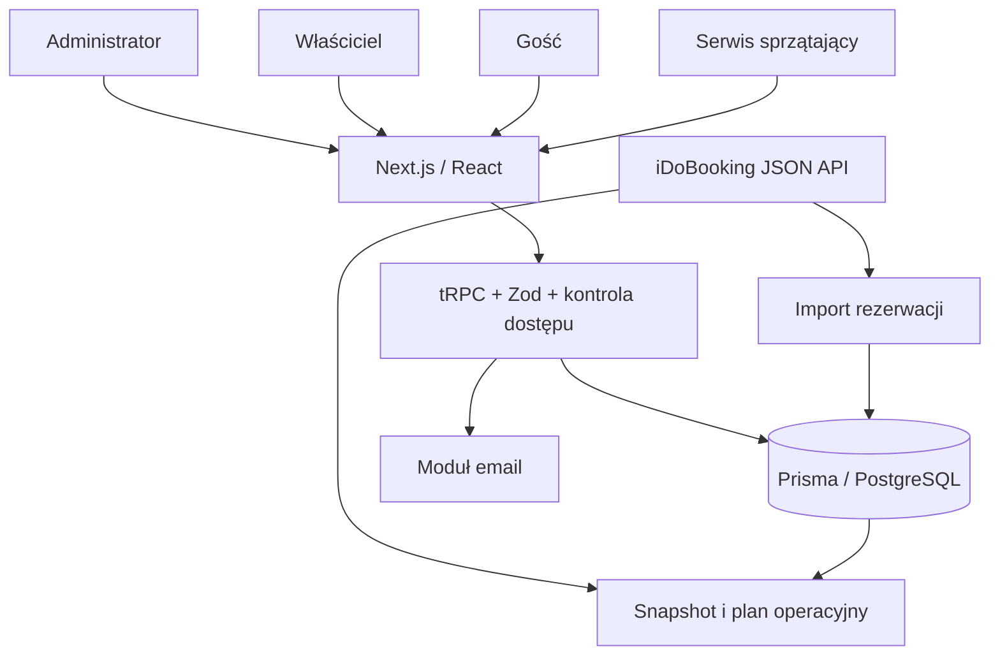

# Jak działa Bookmarket

Stan lokalnego kodu: **24.10.2026**, wersja z `package.json`: **1.2.107**. Projekt znajduje się w `C:\React Workspace\book-market`. Dokument opisuje przegląd kodu, bez uruchamiania produkcyjnej aplikacji.

## Cel i warstwy

Bookmarket obsługuje apartamenty i pokoje, właścicieli, rezerwacje, zameldowanie gości, sprzątanie oraz rozliczenia miesięczne. iDoBooking dostarcza rezerwacje i dane potrzebne do planowania. Lokalna baza przechowuje powiązania, raporty, koszty i dane specyficzne dla Bookmarket.

| Warstwa | Technologia i miejsce |
| --- | --- |
| Interfejs | React 18, Next.js 15.5.9 App Router, TypeScript, Tailwind; `src/app` |
| Komunikacja aplikacyjna | tRPC 11, Zod, React Query; `src/server/api/root.ts`, `src/server/api/routers` |
| Dane | Prisma 5.14, PostgreSQL; `prisma/schema.prisma`, `src/server/db.ts` |
| Tożsamość | NextAuth/Auth.js oraz oddzielne moduły właścicieli, gości i sprzątania |
| Email | Nodemailer i własne szablony; `src/lib/email`, router `email` |
| Integracja z iDoBooking | Synchronizacja v34 w routerze oraz niezależny klient operacyjny, domyślnie v36 |
| Harmonogram | Trasy Next.js i konfiguracja `vercel.json` |

## Główne obszary aplikacji

Administrator korzysta z `/admin`: apartamenty i pokoje, właściciele, rezerwacje, raporty, sprzątanie, statystyki i ustawienia. Operacje trafiają do routerów tRPC, m.in. `apartments`, `rooms`, `apartmentOwners`, `reservation`, `monthlyReports`, `companyStatistics`, `cleaning`, `csvImport` i `idobooking`.

Właściciel korzysta z `/apartamentsOwner`: logowanie, ustawienie lub reset hasła, dashboard, lista apartamentów i pokoi, rezerwacje, raporty, historia podatkowa i profil. Pisownia `apartamentsOwner` jest częścią rzeczywistych ścieżek projektu.

Gość korzysta z `/guest-login/[apartmentSlug]`, `/guest-dashboard/[apartmentSlug]` oraz `/check-in-card/[apartmentSlug]`. Powiązanie pobytu i apartamentu pozwala obsługiwać formularze zameldowania i dane gościa. Warstwa `guestAuth`, `checkIn` i `guestCheckin` jest oddzielona od panelu administratora.

Serwis sprzątający korzysta z `/cleaningService` i `/cleaningService/login`; administrator zarządza pracami w `/admin/cleaning`. Routery `cleaningAuth` i `cleaning` oraz relacja przypisania pracownika do rezerwacji obsługują ten obszar. Osobny endpoint operacyjny wylicza propozycje okien; sam nie przypisuje zadań.

Aktualizacja **25.10.2026**: panel cleaning ma [listę i kalendarz rezerwacji oraz okien sprzątania](cleaning-kalendarz.md) przez nową `cleaning.listOverview`. Rezerwacje, jednostki, adresy i blokady pochodzą z niezależnych odczytów iDoBooking; aktywny katalog Apartment jest czytany tylko dla nazw, zdjęć i potwierdzenia mapowania. Nie czyta finansów ani lokalnych Reservation, nie zapisuje danych i nie zmienia działania admina. Bazowa `cleaning.listCandidates` pozostaje niezależna od katalogu admina. [Reguły backendu](cleaning-backend-etap-1.md).

## Model danych istotny dla integracji

| Model | Znaczenie i relacje |
| --- | --- |
| `Apartment` | Lokal, slug, adres, ustawienia kosztów i rozliczeń, opcjonalny unikalny `idobookingId`; archiwizacja i przedział wyłączenia rezerwacji. |
| `Room` | Rezerwowalny pokój/wariant w apartamencie. |
| `Reservation` | Lokalna pozycja pobytu: daty, status, źródło, gość, kwota, saldo, waluta i liczba osób; relacje do apartamentu, pokoju, sprzątającego i raportów. |
| `ApartmentOwner`, `ApartmentOwnership` | Dane właściciela i przypisania do apartamentów. |
| `MonthlyReport`, `ReportItem`, `ReportHistory` | Rozliczenie okresu, pozycje przychodów/kosztów i historia zmian. |
| `HistoricalReport` i modele historycznych pozycji | Zapis historycznych rozliczeń. |
| `CheckInCard`, `GuestSession` | Dane zameldowania i sesje gości. |
| `CleaningUser` | Użytkownik serwisu sprzątającego i przypisane rezerwacje. |
| `User`, `Account`, `Session` | Tożsamość użytkowników i infrastruktura sesji. |
| `OwnerNote`, `SystemSettings` | Notatki i konfiguracja aplikacji. |

Unikalny klucz integracji rezerwacji to `(idobookingId, idobookingObjectItemId)`. Jedna rezerwacja z iDoBooking może mieć wiele lokalnych wierszy. `objectId` i `objectItemId` oznaczają różne poziomy obiektu. Kwota `paymantValue` jest nazwą rzeczywistego pola w schemacie, nie literówką w tym dokumencie.

## Przepływ rezerwacji i rozliczeń

Import iDoBooking pobiera rezerwacje, normalizuje typy, statusy i kanały, dopasowuje obiekty i zapisuje lokalne pozycje. Lista rezerwacji, kalendarze i raporty korzystają potem z PostgreSQL. Alternatywą jest lokalny import CSV; to osobne źródło danych, z identyfikatorem partii importu, a nie dodatkowy endpoint iDoBooking.

Raporty miesięczne łączą dane rezerwacji z lokalnymi kosztami, prowizjami, ustawieniami apartamentu i właściciela. Oddzielne modele pozycji i historii pozwalają przechowywać rozliczenia oraz ich zmiany. Integracja rozpoznaje kanały sprzedaży, ponieważ wpływają one na kategorie przychodów i prowizje. Szczegółowe reguły rozliczeń są w `monthly-reports.ts` i `company-statistics.ts`; ta dokumentacja integracyjna nie zastępuje specyfikacji finansowej wszystkich tych reguł.

Operacyjny klient iDoBooking pobiera aktualny katalog, pobyty i blokady bez zapisu finansowego. Łączy je z lokalnymi informacjami o obiekcie i zwraca plan. Dzięki temu zapytanie o okno na prace nie wymaga pełnej synchronizacji bazy.

## Mapa plików do dalszego rozwoju

| Obszar | Pliki |
| --- | --- |
| Skład routerów | `src/server/api/root.ts`, `src/server/api/trpc.ts` |
| Import rezerwacji i źródeł | `src/server/api/routers/idobooking.ts` |
| Dostęp do synchronizacji | `src/server/api/routers/idobooking-router.ts` |
| Rozpoznawanie kanału | `src/lib/reservation-channel.ts` |
| Klient odczytu upstream | `src/server/idobooking/operations.ts` |
| Dopasowanie i plan prac | `src/server/idobooking/inventory.ts`, `planning.ts` |
| Endpoint i autoryzacja operacyjna | `src/app/api/operations/reservations/route.ts`, `src/server/idobooking/operations-auth.ts` |
| Cron | `src/app/api/cron/idobooking/route.ts`, `src/app/api/cron/daily-sync/route.ts`, `vercel.json` |
| CLI | `scripts/sync-idobooking.ts`, `scripts/idobooking-operations.mjs` |
| Schemat danych | `prisma/schema.prisma` |
| Raporty | `src/server/api/routers/monthly-reports.ts`, `company-statistics.ts` |

## Uruchamianie i weryfikacja

Polecenia projektu: `npm run dev`, `npm run typecheck`, `npm run lint`, `npm run test`. `npm run dev` i `build` uruchamiają skrypt aktualizacji wersji. Polecenia Prisma mogą zmieniać bazę; do samego czytania tej dokumentacji nie są potrzebne.

`npm run sync:idobooking` zapisuje rezerwacje do skonfigurowanej bazy. `npm run operations:idobooking -- --from YYYY-MM-DD --to YYYY-MM-DD` wykonuje odczyt. Nie należy traktować tych poleceń jako neutralnego testu dokumentacji. `src/test/idobooking.spec.ts` uruchamia integrację z zapisem; bez przygotowanej bazy testowej nie jest właściwym sprawdzeniem samej dokumentacji.

W tym zadaniu sprawdzono kod i spójność archiwum. Nie uruchamiano migracji, pełnego importu, wysyłki wiadomości ani wdrożenia. Szczegóły endpointów i rozbieżności: [integracja-idobooking.md](integracja-idobooking.md). Dokumentacja dostawcy: [archiwum iDoBooking](../idobooking/README.md).
