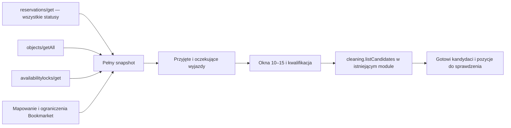

# Historyczny projekt endpointu kandydatów do sprzątania

Ten plik zachowuje wcześniejszy przegląd i projekt. Bieżąca implementacja z 25.10.2026 korzysta z natywnego katalogu iDoBooking, bez mapowania do `Apartment`. Aktualny kontrakt opisuje [endpoint kandydatów](endpoint-kandydatow-sprzatania.md); aktualny UI — [panel cleaning](cleaning-ui-etap-2.md). Poniższe wcześniejsze propozycje współdzielenia danych i reguły mapowania nie opisują bieżącej procedury.

Stan: **25.10.2026**. Po przeglądzie z 24.10 wdrożono lokalnie pierwszy etap backendu: `cleaning.listCandidates`. Szczegóły działającego kontraktu, ograniczenia i wyniki testów opisuje [implementacja etapu 1](cleaning-backend-etap-1.md). Nie utworzono grafiku ani przydziałów; nowe dane nie są jeszcze podłączone do ekranów.

Aktualizacja wymagań **25.10.2026**: właściciel określił orientacyjny czas jednego sprzątania na **60 minut**. Ta wartość zastępuje wcześniejszy szacunek 90 minut w projekcie nowego endpointu.

Uzupełnienie zakresu **25.10.2026**: rozwijamy istniejący moduł cleaning. Nowa metoda i osobny cache odczytu służą temu modułowi. Zgodnie z decyzją właściciela zachowujemy dotychczasowe metody i widoki panelu admina. Kolejne zmiany interfejsu dotyczą panelu `/cleaningService`.

## Decyzja

Podstawowym punktem odczytu jest **nowa procedura `cleaning.listCandidates` w obecnym routerze `src/server/api/routers/cleaning.ts`**. Doda się ją do panelu cleaning w kolejnym etapie. Dotychczasowe `listJobs`, `calendar`, `syncNow` i `assignCleaner` zachowują swoje kontrakty.

Jeżeli późniejszy zewnętrzny proces aktualizacji potrzebuje dostępu przez HTTP, tę samą funkcję można udostępnić przez adapter:

```http
GET /api/operations/cleaning-candidates?from=2026-10-26&to=2026-11-02
Authorization: Bearer <token dostępu do odczytu operacyjnego>
If-None-Match: "<poprzednia rewizja tego samego zakresu>"
```

Obecne metody iDoBooking wystarczą: `reservations/get`, `objects/getAll` i `availabilitylocks/get`, domyślnie w wersji 36. Nie potrzeba nowej metody dostawcy, odczytu płatności ani zmiany statusów rezerwacji. Moduł cleaning ma własną usługę `src/server/cleaning/snapshot.ts` i osobne klucze cache; `/api/operations/reservations` pozostaje bez zmian. Współdzielony jest wyłącznie klient metod odczytu i mapowanie katalogu lokali. Osobna trasa REST nie została dodana; powyższy przykład HTTP dotyczy ewentualnego przyszłego adaptera.

Endpoint ma zwracać **sprzątania możliwe do zaplanowania**, a nie surowe rezerwacje i nie gotowy przydział pracowników. Przyjęte i oczekujące rezerwacje tworzą kandydatów od chwili pojawienia się w kalendarzu. Nie czekamy na opłacenie, rozpoczęcie lub zakończenie pobytu. Dla oczekujących kandydat jest wstępny i podlega późniejszej aktualizacji.

## Co już istnieje i czego brakuje

| Obszar | Obecne zachowanie | Znaczenie dla nowego endpointu |
| --- | --- | --- |
| `cleaning.listJobs`, `src/server/api/routers/cleaning.ts:38` | Wymaga `start >= teraz` oraz `end <= koniec zakresu`. Wyklucza tylko dwa polskie statusy negatywne. | Pomija pobyt rozpoczęty wczoraj, który kończy się dzisiaj. Zwraca pobyty zamiast kwalifikowanych okien sprzątania. |
| `cleaning.calendar`, ten sam plik:224 | Ustawia godziny przez `Date.UTC(...,10/15,...)`. | To godziny UTC, a nie lokalne 10 i 15. 24.10.2026 godzina 10:00Z to 12:00 w Warszawie. |
| `planOperations()`, `src/server/idobooking/planning.ts:4,39` | Tworzy `cleaningProposals` dla `accepted`, `confirmed`, `inProgress`, `completed`; rezerwacje oczekujące tylko blokują lokal. | Brakuje sprzątań dla oczekujących, wymaganych przez właściciela. |
| `cleaningProposals`, ten sam plik | Początek to dokładna godzina wyjazdu, nawet 08:00 albo 16:00. | Brakuje przecięcia z godzinami pracy 10–15. |
| Mapowanie jednostek, ten sam plik:33 | Niejednoznaczne mapowanie blokuje `maintenanceWindows`, ale nie usuwa `cleaningProposals`. | Samo istnienie propozycji i `conflict:false` nie oznacza gotowości do przydziału. |
| `maintenanceWindows` | Są liczone po odjęciu domniemanego sprzątania i bufora przed przyjazdem. | To okna na inne prace. Nie mogą być wejściem do wyznaczania czasu samego sprzątania. |
| `Reservation.cleanerUserId`, `prisma/schema.prisma:89` | Pracownik jest przypisany do rezerwacji. Brak osobnego modelu zadania z czasem wykonania i stanem zakończenia. | Docelowe zadanie sprzątania wymaga własnej tożsamości i cyklu życia. Samego przydziału obecnie nie projektujemy szczegółowo. |
| `/api/operations/reservations` | Pełny odczyt rezerwacji i blokad, cache, token, ETag, kontrola świeżości. | Pozostaje bez zmian. Nowy odczyt cleaning korzysta z tego samego klienta dostawcy, ale ma własną usługę i cache. |

Nowy endpoint nie powinien wywoływać `cleaning.syncNow` ani pełnej synchronizacji finansowej v34. Bezpośredni klient v36 pozwala przygotować listę operacyjną niezależnie od importu danych do raportów.

## Reguła kwalifikacji po doprecyzowaniu właściciela

**Ustalenie biznesowe: zarówno przyjęta, jak i oczekująca rezerwacja tworzy oczekiwane sprzątanie.** Oczekująca może później zmienić daty, lokal, zostać przyjęta albo odrzucona. To zmienia istniejącego kandydata; nie tworzy kolejnego zadania przy każdym odczycie.

Należy rozdzielić trzy informacje:

- `reservationClass`: przyjęta / oczekująca / pobyt trwa / zakończona / anulowana / wymaga wyjaśnienia;
- `certainty`: `accepted` albo `provisional`; obie pozwalają planować;
- `eligibility`: czy konkretne okno jest dostępne, jednoznacznie przypisane do lokalu i wystarczająco długie.

### Normalizacja statusów w v1

| Status źródłowy iDoBooking | Obecna etykieta Bookmarket | Reguła nowej warstwy operacyjnej |
| --- | --- | --- |
| `accepted`, `confirmed` | Przyjęta | Tworzy kandydata z `certainty: accepted`. |
| `waitingForPayment`, `paymentInProgress` | Oczekuje na wpłatę | Tworzy kandydata z `certainty: provisional`. |
| `unconfirmed` | Nieopłacona | Wstępna aktywna rezerwacja, dopóki istnieje w kalendarzu. Sama nazwa „Nieopłacona” nie dowodzi anulowania. Nie wykluczamy jej przez sprawdzenie salda. |
| `inProgress`, `completed` | Trwa, Zakończona | Nie znoszą potrzeby sprzątania po pobycie. Zachować istniejącą pozycję; przy pierwszym odczycie kwalifikować rzeczywisty wyjazd w badanym zakresie. |
| `canceled`, `cancelled`, `withdrawn` | Anulowana, Odrzucona przez obsługę | Nie tworzą nowego sprzątania po przyszłym, niedoszłym pobycie. Wycofać wyłącznie prognozę, dla której nie ma informacji o faktycznym pobycie lub rozpoczęciu prac. |
| `invalidCardNumber`, `toClarify`, nieznany status | Do wyjaśnienia / pozostałe | Nadal blokują dostępność; kwalifikację kandydata skierować do `reviews`. Nie uznawać za pusty lokal. |

Pierwsze dwa wiersze realizują potwierdzone wymaganie. W etapie 1 `unconfirmed` kwalifikuje się jako `provisional`, ponieważ brak wpłaty nie oznacza anulowania. To jawna reguła v1; jej zgodność z rzeczywistymi przypadkami statusów trzeba potwierdzić na koncie przed użyciem do przydziałów. Końcowego odrzucenia/wygaśnięcia nie wnioskujemy z samego braku wpłaty.

Oryginalny `sourceStatus` należy zachować. Obecne mapowanie obu `confirmed` i `accepted` na „Przyjęta” nie pozwala odtworzyć surowego statusu z samej lokalnej etykiety. Reguła statusów powinna być wersjonowana i zarządzana po stronie serwera, a nie dowolnym parametrem użytkownika endpointu.

**Ważne rozdzielenie:** lista rezerwacji tworzących kandydatów jest filtrowana dopiero po pobraniu danych. Do wykrywania zajętości trzeba pobrać wszystkie statusy. Oczekujący lub problematyczny następny przyjazd również ogranicza okno sprzątania.

## Co stanowi jedno sprzątanie

Podstawą jest **wyjazd z konkretnej rezerwowalnej jednostki**: `reservationId + objectItemId`, nie sam `objectId`, nazwa obiektu ani ID rezerwacji bez pozycji.

```text
kandydat = checkout:<konto>:<reservationId>:<objectItemId>
```

Daty, status, nazwisko gościa ani identyfikator następnej rezerwacji nie są częścią klucza. Zmiana daty aktualizuje tę samą pozycję. Rezerwacja z dwoma pokojami daje dwie pozycje. Fizyczna zmiana pokoju wymaga wycofania starego powiązania i powiązania nowego, z zachowaniem historii; jeśli pobyt już trwał, potrzebna jest weryfikacja faktycznego wykorzystania obu lokali.

Kandydat przechowuje powiązania `afterReservationId` i opcjonalnie `beforeReservationId`. Okno między wyjazdem A a przyjazdem B jest jednym sprzątaniem po A przygotowującym lokal dla B. Nie tworzymy drugiej kopii tego samego obrotu tylko dlatego, że B jest nową rezerwacją oczekującą. Jednocześnie już teraz można prognozować osobne sprzątanie po przyszłym wyjeździe B.

Pusty dzień w kalendarzu nie tworzy codziennie nowego sprzątania. Brak kolejnego przyjazdu nie usuwa potrzeby sprzątania po wyjeździe. W v1 preferowana data to dzień wyjazdu; jeżeli się nie mieści, pozycja trafia do wyjaśnienia, bez automatycznego przesuwania na inny dzień.

Przy pierwszym przyjeździe bez znanej historii wyjazdu trzeba sprawdzić gotowość lokalu; sama rezerwacja nie dowodzi, że lokal jest brudny ani że był posprzątany. Ewentualne zadanie przygotowania przed pierwszym przyjazdem powinno mieć osobny, jawny powód, zamiast tworzyć fikcyjny poprzedni wyjazd.

## Wyznaczenie okna 10–15

Strefa biznesowa: **Europe/Warsaw**. Daty `from` i `to` są datami lokalnymi; `to` jest wyłączne. Czasy API są lokalnymi godzinami panelu i muszą być poprawnie interpretowane w tej strefie. W odpowiedzi należy używać ISO z offsetem, np. 26.10.2026 `10:00+01:00`, a nie doklejać `Z` do polskiej godziny.

Dla dnia wyjazdu D:

```text
początek = max(D 10:00, rzeczywisty lub umowny checkout)
koniec   = min(D 15:00, najbliższy blokujący przyjazd - bufor)
wolne okna = [początek, koniec) minus pozostałe pobyty i blokady
można planować, jeśli choć jedno wolne okno mieści cały szacowany czas sprzątania
```

Okno 10–15 to 300 minut dostępności, nie czas trwania pojedynczego sprzątania. Koniec sprzątania dokładnie o 15:00 jest dopuszczalny przy zerowym buforze. Jeśli źródło potwierdza późniejszy wyjazd lub wcześniejszy przyjazd, te godziny mają pierwszeństwo przed domyślnymi 10/15.

W nowej polityce proponowany bufor przed przyjazdem to **0 minut**, żeby zachować wskazane przez właściciela pięć godzin. Obecny moduł prac ma domyślnie 30 minut; nie należy przenosić go po cichu do nowej reguły. Jeśli później ustalimy bufor 30 minut, odpowiedź jawnie pokaże okno 10:00–14:30.

Szacowany czas: **60 minut na jedno sprzątanie**, zgodnie z ustaleniem właściciela z 25.10.2026. Konfiguracja jednostki może później jawnie określać wyjątki. Odpowiedź podaje pochodzenie szacunku. Historyczny moduł operacyjny zachowuje swój domyślny czas 90 minut; nowy widok cleaning ma korzystać z polityki `listCandidates`. Nie jest to pomiar czasu konkretnej sprzątaczki.

Uwzględnić blokady jednostki i całego obiektu, wycofanie lokalu, `reservationsDisabled`, niejednoznaczne mapowanie i informacje o przeniesieniach. Blokada z opisem nie stanowi automatycznie sprzątania ani dowodu rzeczywistego pobytu. Niepewną semantykę ostatniego dnia blokady zachowawczo wyłączyć z automatycznego planowania i wskazać do sprawdzenia.

## Źródła i przepływ danych



Użyć `betweenDateRange`, aby uwzględnić pobyt rozpoczęty przed `from`. Kandydatów wybierać po lokalnym dniu **wyjazdu** w `[from,to)`. Nie stosować `start >= teraz`. Najbliższy przyjazd wpływający na pracę tego dnia musi być w tym samym kontekście zajętości. `nextArrival:null` oznacza brak przyjazdu w pokrytym zakresie, a nie gwarancję wolnego lokalu w dowolnej przyszłości.

Na start wystarczy pełne uzgodnienie krótkiego horyzontu, np. 7–14 dni, maksymalnie 31 dni na zapytanie. Czytać wszystkie strony oraz wszystkie blokady. Błąd lub niepełna paginacja nie mogą zamienić się w odpowiedź „brak rezerwacji, wolny lokal”.

Odczyt cleaning działa w `src/server/cleaning/snapshot.ts`, a reguły w `src/server/cleaning/candidates.ts`. Nie wydzielono ani nie zmieniono starej trasy operacyjnej. Nowa procedura nie czyta tabeli `Reservation`, nie synchronizuje finansów i nie zapisuje niczego do bazy. Z katalogu `Apartment` pobiera tylko identyfikatory, nazwę, adres i ograniczenia dostępności. Reguły `maintenanceWindows` pozostają bez zmian.

### Uzupełnienie istniejących elementów

| Istniejący element | Planowane uzupełnienie |
| --- | --- |
| `cleaning.listJobs`, `cleaning.calendar` | Zachować istniejące kontrakty. Nowy ekran kwalifikacji ma używać `cleaning.listCandidates`. |
| `/admin/cleaning` | Bez zmian w tym zadaniu. |
| `/cleaningService` | W następnym etapie dodać widok kandydatów dla koordynatora; zwykły pracownik docelowo widzi własne przydziały. |
| `cleaning.assignCleaner` | Zachować starą metodę; przyszłe zadania otrzymają odrębny mechanizm przydziału i rewizji. |

W etapie 1 wdrożono backend listy kandydatów. Automatyczne wybieranie pracownika i układanie kolejności prac należą do późniejszego rozszerzenia tego samego modułu.

## Kontrakt odpowiedzi

Parametry v1:

| Parametr | Reguła |
| --- | --- |
| `from`, `to` | Wymagane daty `YYYY-MM-DD`; lokalny zakres 1–31 dni, `to` wyłączne. |
| `unitId` | Opcjonalny identyfikator konkretnego `objectItemId`; filtrowanie dopiero po zbudowaniu pełnego kontekstu zajętości. |
| `includeReviews` | Domyślnie `true`; zwraca też pozycje wymagające sprawdzenia. Zawsze zwracać ich liczbę, nawet gdy szczegóły są wyłączone. |

Odpowiedź zawiera:

- `candidates[]`: wyłącznie pozycje gotowe do **planowania**, zarówno przyjęte, jak i wstępne;
- `reviews[]`: kandydaci z niejednoznacznym statusem, mapowaniem, blokadą, przeniesieniem lub za krótkim oknem; z kodami powodów;
- `source`: wersja API i kompletność rezerwacji oraz blokad; `fetchedAt` jest osobnym polem, a zakres pozostaje w `from` i `to`;
- `policy`: wersja reguł, 10–15, strefa, bufor, szacunki i ograniczenia przyszłego przydziału;
- `revision`: rewizja całej reprezentacji oraz `candidateRevision` dla każdej pozycji.

Każdy kandydat: stabilne ID, lokal/pokój i adres, dzień sprzątania, powiązany wyjazd, opcjonalny kolejny przyjazd i jego status, `certainty`, dopuszczalne `windows[]`, czas sprzątania i źródło szacunku. **Nie zwracać konkretnego `scheduledStart` ani `cleanerId`: to zadanie przyszłego modułu grafiku.** `entryRequiresConfirmation:true` odróżnia możliwość planowania od potwierdzenia faktycznego dostępu do lokalu.

Przykładowa odpowiedź z dwiema fikcyjnymi pozycjami — przyjętą i oczekującą: [cleaning-candidates.example.json](cleaning-candidates.example.json). To przykład kontraktu, a nie rzeczywiste rezerwacje lub grafik.

Bez danych płatniczych, nazwisk i kontaktów gości, dokumentów, kodów wejścia i pełnych notatek. Do modułu planowania wystarczą identyfikatory rezerwacji. Z notatek i blokad wystawić identyfikator oraz powód wymaganej weryfikacji.

### Odpowiedzi HTTP i dostęp

Wdrożony adapter tRPC zwraca kompletny wynik albo błędy `BAD_REQUEST`, `UNAUTHORIZED`, `FORBIDDEN`, `NOT_FOUND`, `BAD_GATEWAY` i `SERVICE_UNAVAILABLE`. Tłumaczenie na HTTP obsługuje tRPC. V1 zwraca `revision`, ale nie implementuje własnego ETag ani `304`. Taką obsługę można dodać w przyszłym adapterze REST. Błąd nie może nadpisywać ostatniego poprawnego stanu ani usuwać zaplanowanych sprzątań.

Dostęp do nowej procedury wymaga zweryfikowanego JWT cleaning z rolą `CLEANING_ADMIN`, `MANAGER` lub `ADMIN`, albo istniejącej sesji administratora aplikacji. Nie dodano tokenu operacyjnego do frontendu. Zwykły `CLEANER` nie otrzymuje pełnego feedu planowania.

## Odświeżanie około dwa razy dziennie

Przyszły proces uzgadniania wywołuje endpoint mniej więcej dwa razy dziennie dla tego samego horyzontu. **Częstotliwość pracy konsumenta nie oznacza cache'u danych iDoBooking przez 12 godzin.** Każde takie wywołanie ma korzystać ze świeżego odczytu; można współdzielić cache snapshotu 60 sekund i katalogu 24 godziny, z odświeżeniem katalogu przy nowej jednostce, jak w istniejącym module. Starszy niż 5 minut snapshot nie powinien być podstawą nowego automatycznego przydziału.

Na początek wdrożono pełną odpowiedź, stabilne ID oraz rewizje SHA-256 danych. Znacznik pobrania leży poza rewizją i nie generuje pozornych zmian. Rewizja obejmuje stan źródłowy, pewność rezerwacji, okna, mapowanie i wersję polityki. ETag i `304` pozostają pomysłem dla przyszłego adaptera REST.

| Zdarzenie | Zmiana listy kandydatów |
| --- | --- |
| Nowa przyjęta rezerwacja | Nowa oczekiwana pozycja po jej wyjeździe. Aktualizacja terminu wcześniejszego sprzątania przed jej przyjazdem. |
| Nowa oczekująca rezerwacja | Tak samo, ale `certainty: provisional`. |
| Oczekująca → przyjęta | To samo ID; aktualizacja pewności i rewizji, bez duplikatu lub niepotrzebnego przesuwania pracy. |
| Zmiana dnia/godziny wyjazdu | To samo ID; zmiana dnia i okien, z informacją o wpływie na wcześniejszy przydział. |
| Zmiana następnego przyjazdu | Aktualizacja deadline'u i okien istniejącego kandydata. |
| Przeniesienie do innej jednostki | Zmiana powiązań i weryfikacja fizycznego pobytu; nie kasować historii automatycznie. |
| Anulowanie przyszłego, niedoszłego pobytu | Wycofanie powiązanej prognozy; ponowne policzenie poprzedniego okna. |
| Anulowanie po możliwym faktycznym pobycie | Docelowo wymaga weryfikacji. Bez historii zadań v1 zwraca `excluded` z powodem `RESERVATION_INACTIVE`; nie usuwa żadnych zadań i nie dowodzi, że lokal jest czysty. |
| Nowa blokada lub za krótkie okno | Przejście do `reviews`; potrzebny kandydat nie może zniknąć bez powodu. |

Porównanie dotyczy **tego samego zakresu**, konta, jednostek i polityki. Wyjście pozycji poza przesuwany horyzont nie oznacza anulowania. Przyszły konsument musi odróżniać `out_of_scope` od `source_cancelled`; nie wolno usuwać zadania wyłącznie na podstawie braku ID w innym zapytaniu. V1 nie udaje trwałego cursora — delty serwerowe można dodać po wdrożeniu historii snapshotów.

Dwa odczyty dziennie nie wychwycą natychmiast każdej zmiany. Przed przyszłym zatwierdzeniem przydziału lub istotną korektą potrzebna jest kontrola aktualnej rewizji okna. W tym zadaniu nie ustawiono harmonogramu wywołań.

## Stan potrzebny do późniejszej obsługi grafiku

Samo API iDoBooking nie powie, czy sprzątanie zostało wykonane. `cleanerUserId` na rezerwacji także tego nie opisuje. Endpoint v1 może już dostarczać prognozowane kandydatury; przed automatyczną aktualizacją rzeczywistych zadań potrzebny będzie lokalny model `CleaningTask` z:

- unikalnym kluczem kandydata, jednostką i powiązaniem z wyjazdem;
- stanem zadania, rewizją źródła, czasem aktualizacji oraz informacją o ręcznej korekcie;
- informacją o rozpoczęciu/wykonaniu i przyczyną wycofania;
- w dalszym etapie: wybraną godziną i pracownikiem.

GET pozostaje odczytem: nie tworzy zadań i nie przydziela sprzątaczek. Późniejszy proces uzgadniania będzie scalał wynik z lokalnymi zadaniami. Zadań rozpoczętych, zakończonych i ręcznie zablokowanych nie można automatycznie usuwać albo przenosić po zmianie rezerwacji; konflikty wymagają decyzji koordynatora.

Nie potrzeba obecnie publicznego endpointu do generowania grafiku. Jeśli docelowy mechanizm uruchamiania wymaga trasy crona, będzie ona osobnym, chronionym adapterem procesu uzgadniania, a nie odpowiedzialnością endpointu odczytu.

## Limit trzech–czterech sprzątań

Wymaganie dla późniejszego przydziału: preferowane najwyżej 3, maksymalnie 4 sprzątania na osobę dziennie w oknie 10–15. Endpoint przekazuje te ograniczenia i czas każdego sprzątania; **nie sprawdza jeszcze dostępności konkretnej osoby ani nie układa kolejności**.

Przy ustalonym szacunku 60 minut: 3 × 60 = 180 minut, a 4 × 60 = 240 minut. W oknie 10–15 pozostaje odpowiednio 120 lub 60 minut na dojazdy, przerwy i bufor. Cztery sprzątania są czasowo możliwe, jeśli przejazdy i przerwy mieszczą się w pozostałej godzinie, a okna konkretnych lokali pozwalają na taką kolejność. Piątego nie przydzielamy, nawet gdy sama suma czasów sprzątania wyniosłaby 300 minut. Przyszły moduł musi uwzględnić sumę czasów, dojazdy i przerwy, nie wyłącznie liczbę zadań.

## Kolejność wdrożenia i kryteria odbioru

1. Utrwalić powyższe grupy statusów w jednej funkcji normalizacji, z zachowaniem oryginału; zweryfikować niejednoznaczne `unconfirmed` na panelu. Przyjęte i oczekujące muszą przechodzić identyczne sprawdzenie dostępności okna.
2. Wdrożono osobny snapshot cleaning i mapowanie po ID. Dopasowanie wyłącznie nazwą trafia do sprawdzenia. Nie odczytujemy flag przeniesień z tabeli rezerwacji admina; sam feed nie rozstrzyga faktycznej historii przeniesienia.
3. Dodać czystą funkcję `buildCleaningCandidates(snapshot, policy)`: stabilne ID, 10–15, czas sprzątania, blokady i listę powodów `reviews`. Nie wykorzystywać gotowych `maintenanceWindows` jako wejścia.
4. Wdrożono `cleaning.listCandidates` z walidacją i kontrolą dostępu. Następny etap to podłączenie panelu cleaning; istniejące widoki i procedury admina pozostają bez zmian. Ewentualna trasa HTTP z ETag ma korzystać z tej samej funkcji domenowej.
5. Przetestować przypadki: przyjęta; oczekująca; oczekująca → przyjęta; oczekująca → odrzucona; rozpoczęcie przed zakresem; kilka jednostek; przesunięcie dat; brak następnego przyjazdu; luka kilkudniowa; wyjazd przed 10 i po 15; wcześniejszy przyjazd; blokady; nieznany status/mapowanie; zmiana czasu w Warszawie; niepełny i stary snapshot; stabilność ID/ETag; różne zakresy bez fałszywych anulowań.
6. Dopiero później dodać trwałe zadania, przydziały i dwukrotne dzienne uzgadnianie grafiku.

Kody powodów do uzgodnienia w v1: `INSUFFICIENT_WINDOW`, `OUTSIDE_WORK_HOURS`, `OCCUPANCY_OVERLAP`, `AVAILABILITY_LOCK`, `UNVERIFIED_UNIT_MAPPING`, `PROPERTY_DISABLED`, `RELOCATION_REVIEW`, `UNKNOWN_STATUS`, `POSSIBLE_STAY_AFTER_CANCELLATION`. Nazwa kodu nie powinna zastępować krótkiego opisu dla koordynatora.

## Weryfikacja tego przeglądu

Uruchomiono **14 istniejących testów** w trzech plikach: `planning.test.ts`, `operations-route.test.ts`, `availability-locks.test.ts`; wszystkie przeszły. Korzystają z atrap i nie wykonują odczytów produkcyjnego konta. To testy obecnej implementacji, nie dowód wdrożenia proponowanego kontraktu.

Dodatkowo wykonano sześć syntetycznych odczytów obecnej funkcji `planOperations()`. Potwierdziły brak propozycji dla `waitingForPayment`, propozycję 08:00–09:30 dla wyjazdu o 08:00, propozycję 16:00–17:30 dla wyjazdu o 16:00 oraz propozycję mimo `mapping: unmapped`. Standardowy obrót daje okno na inne prace 11:30–14:30, a nie pełne okno sprzątania 10–15. Oczekujący wcześniejszy przyjazd prawidłowo powoduje konflikt. [Wyniki syntetyczne](cleaning-review-evidence.json).

Powyższe wyniki opisują dotychczasowy kod z jego historycznym domyślnym czasem 90 minut. Zachowano je jako dowód przeglądu; nowy kontrakt i przykładowa odpowiedź używają ustalonych 60 minut.

Źródła lokalne: `src/server/api/routers/cleaning.ts`, `src/app/admin/cleaning/page.tsx`, `src/server/idobooking/{operations,planning,inventory}.ts`, `src/app/api/operations/reservations/route.ts`, `prisma/schema.prisma` oraz zebrane kontrakty [reservations/get](../idobooking/api/reservations/get.md), [objects/getAll](../idobooking/api/objects/getAll.md), [availabilitylocks/get](../idobooking/api/availabilitylocks/get.md). Sam przegląd z 24.10 nie zmieniał kodu. Implementację z 25.10 i jej weryfikację opisano w [raporcie etapu 1](cleaning-backend-etap-1.md).
