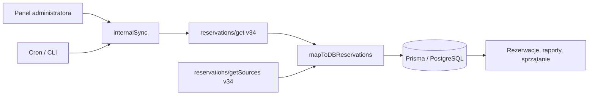

# Integracja Bookmarket z iDoBooking

Bazowy audyt statyczny: **24.10.2026**, rozszerzony **25.10.2026** o natywny backend i UI cleaning. Odczyty cleaning zweryfikowano także na rzeczywistym iDoBooking przez lokalny interfejs, bez uruchamiania synchronizacji i zapisów do rezerwacji. [Opis weryfikacji](cleaning-ui-etap-2.md). Obecność trasy w lokalnym kodzie nie potwierdza jej wdrożenia produkcyjnego.

## Używane endpointy dostawcy

Po rozszerzeniu cleaning z **25.10.2026** w aplikacji występuje **5 różnych metod iDoBooking, używanych przez 6 adresów z wersją API**. Wszystkie wywołania upstream używają HTTPS, HTTP **POST** i JSON. Nazwa metody `get` nie oznacza HTTP GET. Kierunek przepływu danych: iDoBooking → Bookmarket. Stara synchronizacja zmienia lokalną bazę; nowy odczyt cleaning nie zapisuje niczego do bazy ani iDoBooking.

| Endpoint względem hosta | Cel i wywołujący kod | Żądanie i paginacja | Wykorzystywana odpowiedź |
| --- | --- | --- | --- |
| `/api/objects/getLocation/{version}/json` — domyślnie 36 | Niezależny katalog adresów cleaning. `enrichCleaningLocations()`, `src/server/cleaning/locations.ts`. | `paramsSearchObjectLocation.objects: [{id: objectId}]`; partie po maksymalnie 100 unikalnych obiektów. | `objectLocations[].objectId/locationId/address`; jawne braki i niejednoznaczności, bez danych katalogu admina. |
| `/api/reservations/get/34/json` | Import i aktualizacja rezerwacji w bazie. `getReservations()` w `src/server/api/routers/idobooking.ts:273`. | `authenticate`, `paramsSearch.fromDateRange.{startDate,endDate}`, `result.{page,number}`; strony od 1, po 100. | Koperta `result`, a wewnątrz `authenticate`, `errors`, `reservations`, `result.pageAll/countAll`; dane pobytu, pozycji, klienta, kwoty i saldo. |
| `/api/reservations/getSources/34/json` | Katalog źródeł rezerwacji do rozpoznania kanału sprzedaży. `getSources()` w `src/server/api/routers/idobooking.ts:944`. Wywoływane przy niepustej synchronizacji i osobno przez panel. | `authenticate`, `result: {page:1,number:100}`; kod wykonuje tylko jedno żądanie. | `result.sources[]`: `reservationSourceTypeId`, `reservationSourceTypeName`, `reservationSourceId`, `reservationSourceName`. |
| `/api/objects/getAll/{version}/json` — domyślnie 36 | Katalog jednostek do planowania. `readClient().units()`, `src/server/idobooking/operations.ts:73,178`. | `authenticate`, `result.{page,number}`; strony od 1, po 100; sprawdzana kompletność. | `objects[].id/name`, `objects[].items[].id/code/name` oraz metadane paginacji. |
| `/api/reservations/get/{version}/json` — domyślnie 36 | Pobyty do okien prac i sprzątania; osobno jawny odczyt notatek. `readClient().stays()` i `.reservationNotes()`, `src/server/idobooking/operations.ts:157,192`. | `paramsSearch.betweenDateRange`; `result: {page,number:100,returnElements:["reservationDetails","items"]}`; pełna paginacja. | `id`, `reservationDetails.dateFrom/dateTo/status`, `items[].objectItemId`; odczyt notatek dodatkowo `internalNote`, `apiNote`. |
| `/api/availabilitylocks/get/{version}/json` — domyślnie 36 | Blokady dostępności, które również ograniczają prace. `readClient().availabilityLocks()`, `src/server/idobooking/operations.ts:123`. | `authenticate`, `result.{page,number:100}`; bez filtra dat upstream. Czytanie od strony 1 aż do pustej strony, maksymalnie 500 stron. | `availabilityLocks[].id/itemId/objectId/dateFrom/dateTo/note`; filtrowanie zakresu lokalnie po pełnym odczycie. |

Starszy moduł ma na stałe host `https://zlote-wynajmy.pl` i wersję 34. Moduł operacyjny korzysta z `IDOBOOKING_BASE_URL` (domyślnie ten sam host) i `IDOBOOKING_API_VERSION` (domyślnie `36`). Rozwiązanie adresu jest deterministyczne; dynamiczna część `gateway` może w tym kodzie przyjąć wyłącznie `objects` albo `reservations`.

**Liczba w segmencie `/34/json` lub `/36/json` to wersja API.** Komentarz przy starszym `fetch`, opisujący ją jako identyfikator grupy obiektów, jest mylący. Nie należy używać tego komentarza jako specyfikacji integracji.

Dokładne pola i przykłady dostawcy: [reservations/get v34](../idobooking/api-v34/reservations/get.md), [getSources v34](../idobooking/api-v34/reservations/getSources.md), [reservations/get v36](../idobooking/api/reservations/get.md), [objects/getAll v36](../idobooking/api/objects/getAll.md), [availabilitylocks/get v36](../idobooking/api/availabilitylocks/get.md). [Maszynowy spis wywołań Bookmarket](endpoints-idobooking.json).

## Transport i uwierzytelnienie

Nagłówki żądania obu modułów:

```http
Accept: application/json
Content-Type: application/json;charset=UTF-8
```

Treść uwierzytelnienia:

```json
{
  "authenticate": {
    "systemLogin": "<login użytkownika panelu>",
    "systemKey": "<SHA1(YYYYMMDD + SHA1(hasło))>",
    "lang": "pol"
  }
}
```

`systemKey` jest wyliczany dla daty danego dnia. Starszy `generateSystemKey()` używa lokalnej strefy procesu Node. Nowszy `systemKey()` wyznacza datę w jawnej `IDOBOOKING_TIME_ZONE`, domyślnie `Europe/Warsaw`. Różnica ma znaczenie w okolicy północy. W istniejącej synchronizacji v34 dane logowania są wpisane w kodzie `getAuth()`; w module operacyjnym pochodzą ze zmiennych środowiska. Ich wartości celowo nie są kopiowane do dokumentacji.

Moduł operacyjny dopuszcza wyłącznie origin HTTPS, bez ścieżki, query, fragmentu i danych logowania w URL. Każde żądanie ma timeout 30 sekund, `redirect: "error"` i `cache: "no-store"`; cache jest obsługiwany wyżej. Starsze żądania v34 nie mają jawnego timeoutu ani polityki przekierowań. Oba korzystają ze standardowego `fetch`, z domyślną weryfikacją TLS.

## Synchronizacja rezerwacji do lokalnej bazy



1. `internalSync()` pobiera strony rezerwacji i przekazuje je do `mapToDBReservations()`. Domyślne okno zaczyna się 18 miesięcy wstecz i kończy `2100-01-01`; granice można przekazać jako ISO.
2. Filtr `fromDateRange` dotyczy **daty rozpoczęcia pobytu**. Nie zastępuje filtra pobytów nachodzących na określony zakres.
3. Odpowiedź jest sprawdzana przez Zod. Koperta zawiera `result.reservations`, a metadane stron znajdują się w `result.result`. Przy braku metadanych starszy kod traktuje odpowiedź jako jedyną stronę. Wstępna walidacja całej koperty obejmuje też elementy rezerwacji, więc nie każdy nieprawidłowy rekord dotrze do późniejszego `safeParse`.
4. Dla niepustego importu pobierany jest katalog źródeł. Błąd tego odczytu nie zatrzymuje mapowania: kod przechodzi na lokalne reguły rozpoznawania kanałów.
5. Rezerwacja z kilkoma pozycjami tworzy kilka lokalnych wierszy. Klucz unikalny bazy: **`idobookingId + idobookingObjectItemId`**. Wartość `0` obsługuje stare rekordy; brak `objectItemId` w nowym rekordzie zastępuje dyskryminator `1_000_000 + indeks pozycji`.
6. Nowe rekordy dopasowuje się do `Apartment` po ID, a następnie po znormalizowanej nazwie i wariancie `itemCode`. Dla przypisanego apartamentu kod wyszukuje lub tworzy lokalny `Room`. Nowe rezerwacje zapisuje przez `createMany(skipDuplicates:true)`, aktualizacje w paczkach po 6.
7. Zmiana źródła rezerwacji aktualizuje również kategorię powiązanych automatycznych pozycji przychodowych `ReportItem`. Synchronizacja nie usuwa automatycznie lokalnych rekordów tylko dlatego, że nie pojawiły się w odpowiedzi danego okna.

### Mapowanie głównych pól

| iDoBooking | Bookmarket / reguła |
| --- | --- |
| `id` | `Reservation.idobookingId` |
| `items[].objectItemId` | `idobookingObjectItemId`; identyfikuje jednostkę, a nie nadrzędną grupę `objectId` |
| `reservationDetails.dateAdd` | `createDate` |
| `reservationDetails.dateFrom`, `dateTo` | `start`, `end` |
| `client.firstName`, `lastName` | `guest`; przy braku danych nowy rekord otrzymuje „Nieznany gość” |
| `items[].objectName`, `itemCode` | nazwa apartamentu, wariant/pokój i dopasowanie lokalnego obiektu |
| `reservationDetails.price` | kwota pojedynczej pozycji rezerwacji |
| `items[].price + priceCorrection` | kwota danej pozycji przy rezerwacji wielopozycyjnej |
| wyliczona kwota | `paymantValue` (pisownia istniejącego modelu) oraz tekstowe `payment`; nie jest to dowód dokonanej wpłaty |
| `reservationDetails.balance` | `balance`, brak danych → `null` |
| `reservationDetails.currency` | waluta przy tworzeniu nowego rekordu; istniejąca gałąź aktualizacji nie aktualizuje tego pola |
| `numberOfAdults`, ewentualnie `numberOfGuests` | `adults`, domyślnie 1 |
| `numberOfBigChildren + numberOfSmallChildren` | `children` |
| `reservationSourceId`, `internalSource` | `source`, rozpoznawane przez `src/lib/reservation-channel.ts` |

Kanały: ID 8 → Booking, ID 14 → Airbnb; kod rozpoznaje także widget iDoBooking, Złote Wynajmy, email, telefon, kontakt osobisty i social media. Są to reguły aktualnego projektu, a nie uniwersalna gwarancja identyfikatorów dla każdego konta. Sam napis „IdoBooking” nie oznacza Booking.com. `allotments/sources` nie zastępuje `reservations/getSources`: zwraca inne pola i służy dostępności w źródłach sprzedaży.

Statusy w synchronizacji: `unconfirmed` → Nieopłacona; `confirmed`/`accepted` → Przyjęta; `paymentInProgress`/`waitingForPayment` → Oczekuje na wpłatę; `inProgress` → Trwa; `completed` → Zakończona; `canceled` → Anulowana; `withdrawn` → Odrzucona przez obsługę; `invalidCardNumber` → Niepoprawny numer karty; `toClarify` → Do wyjaśnienia. Nieznany status pozostaje tekstem źródłowym.

## Odczyt operacyjny: rezerwacje, jednostki i blokady

Ten moduł działa niezależnie od zapisu finansowego. Pobiera katalog, pobyty i blokady, a następnie buduje snapshot i plan prac. Nie uruchamia `internalSync()`.

Przykładowe żądanie dla pobytów:

```json
{
  "authenticate": {"systemLogin":"<login>","systemKey":"<klucz dnia>","lang":"pol"},
  "paramsSearch": {"betweenDateRange":{"startDate":"2026-10-24 00:00","endDate":"2026-10-25 00:00"}},
  "result": {"page":1,"number":100,"returnElements":["reservationDetails","items"]}
}
```

Dla `objects/getAll` brak `paramsSearch` i `returnElements`; dla blokad wysyłane są wyłącznie `authenticate` i `result`. Nie należy wysyłać powyższego przykładu bezpośrednio do każdej metody.

Paginacja obiektów i rezerwacji sprawdza obecność metadanych, stałe `countAll`, limit stron, niepuste strony pośrednie i zgodność łącznej liczby wyników. Niejednoznaczny lub niepełny snapshot kończy się błędem. Akceptowana jest zarówno koperta `result`, jak i odpowiedź z listą na najwyższym poziomie.

Blokady są czytane do pustej strony, także po stronie krótszej niż 100 rekordów. Kod odrzuca błędy i powtórzone ID. Daty filtruje lokalnie (`from < toZapytania && to >= fromZapytania`), aby nie zgubić długiej blokady. Komentarze i wcześniejsza dokumentacja projektu podają, że rzeczywiste API zaczyna paginację blokad od 1, mimo opisu 0 w dokumentacji dostawcy; tego zachowania nie sprawdzano ponownie na koncie w tym audycie.

Zakres odczytu ma 1–31 dni; `to` jest wyłączne. Daty i godziny pobytów zachowują lokalną semantykę panelu, a snapshot podaje `timeZone`. `object.items[].id` odpowiada `items[].objectItemId` rezerwacji. Mapowanie do Bookmarket używa `Apartment.idobookingId`, ewentualnie jednoznacznej nazwy. Obiekt wycofany, wyłączone rezerwacje, nieznane mapowanie, rezerwacje i blokady ograniczają publikowane okna prac.

Plan domyślnie zakłada 90 minut sprzątania i 30 minut bufora przed przyjazdem; szuka okien prac 10–15, minimum 30 minut. Są to założenia aplikacji. Końcowy dzień blokady jest zachowawczo zajęty w całości. Wynik nie dowodzi zgody na wejście ani posprzątania. Notatka o przeniesieniu jest wskazaniem do sprawdzenia, nie podstawą automatycznego anulowania rezerwacji.

## Panel cleaning — lista i kalendarz

Nowy ekran `/cleaningService` używa `cleaning.access` i `cleaning.listOverview`. [Kontrakt i potwierdzone mapowanie](cleaning-kalendarz.md) opisują osobny odczyt iDoBooking oraz aktywnego katalogu nazw/zdjęć Apartment, bez zapisu lub uruchamiania synchronizacji admina. Cleaning stosuje 60 minut i rzeczywiste okna 10–15. Status `toClarify` odpowiada potwierdzonej w UI etykiecie „Oczekująca” i jest w cleaning klasyfikowany jako wstępny; historyczna etykieta admina opisana wyżej pozostaje bez zmian.

## Punkty wejścia Bookmarket

| Punkt wejścia | Dostęp i działanie |
| --- | --- |
| `idobooking.syncReservations` przez `/api/trpc/[trpc]` | Mutacja tRPC, `protectedProcedure` i rola ADMIN; pełny import v34. |
| `idobooking.syncReservationsCron` | `publicProcedure`; sprawdza Bearer, jeżeli `CRON_SECRET` jest ustawiony. Przyjmuje opcjonalne granice dat. |
| `idobooking.getReservationSources` | Mutacja tRPC, ADMIN; osobny odczyt katalogu v34. |
| `GET /api/cron/idobooking` | Wywołuje cron tRPC; `vercel.json` wskazuje `*/20 * * * *`. Trasa sama dodaje `CRON_SECRET` do kontekstu tRPC. |
| `GET /api/cron/daily-sync` | Pełna synchronizacja w oknie 24 miesiące wstecz do 18 naprzód; brak tej trasy w harmonogramie obecnego `vercel.json`. Wywołuje ją także moduł sprzątania. |
| `npm run sync:idobooking` | CLI `scripts/sync-idobooking.ts`, bez sesji HTTP; zapis do bazy. |
| `GET /api/operations/reservations` | Odczyt z osobnym Bearer `OPERATIONS_API_TOKEN`; plan lub lista pobytów, bez zapisu do bazy. |
| `npm run operations:idobooking -- ...` | CLI odczytu bezpośrednio z iDoBooking albo przez `--app-url` endpointu Bookmarket. |

Operacyjny endpoint wymaga `from`, `to`; obsługuje `view=plan|reservations`, `unitId`, `cleaningMinutes`, `arrivalBufferMinutes`. Zwraca 401 przy złym tokenie, 400 dla niepoprawnych parametrów, 404 dla nieznanej jednostki, 502 przy niepełnym odczycie upstream i 503 przy snapshotcie starszym niż 5 minut. Katalog jest cache'owany 24 godziny, snapshot 60 sekund. `ETag`/`If-None-Match` daje 304 przy identycznym stanie. CLI ma oddzielny cache i emituje zmiany `upsert`/usunięte ID, zamiast zawsze pełnej listy.

## Ograniczenia i kolejność dalszych prac

1. Ujednolicić konfigurację hosta, wersji API, strefy i poświadczeń. Starszy `getAuth()` zawiera stałe dane; nie należy przenosić ich do nowych przykładów lub dokumentów. Warto przejść na wspólny klient z konfiguracji środowiska.
2. Zweryfikować kontrolę wejściowego żądania do `/api/cron/idobooking`: lokalny kod nie sprawdza otrzymanego Bearera przed dodaniem sekretu do kontekstu. To opis istniejącej implementacji, nie potwierdzenie ochrony po stronie hostingu.
3. Ujednolicić obsługę błędów, timeouty i paginację. `getSources()` v34 loguje surową odpowiedź, nie sprawdza `response.ok` i nie iteruje stron; koperta odpowiedzi może zawierać uwierzytelnienie. Nowszy klient pokazuje tylko kody błędów.
4. Przed migracją v34 → v36 porównać lokalnie wymagane pola, odpowiedzi null/string/number, statusy, ceny wielopozycyjne, granice dat i katalog źródeł. Archiwum zawiera oba używane kontrakty v34 i bieżącą wersję 36. Migracji nie wykonano w ramach dokumentowania.
5. Doprecyzować aktualizację waluty, zmianę jednostki i dopasowania lokalnego obiektu. Istniejąca gałąź aktualizacji nie odtwarza całego mapowania tworzenia nowego rekordu.
6. Dla większej skali rozważyć `modificationDateRange` z trwałym cursorem, zakładką czasową i okresowym pełnym uzgodnieniem. Obecny import nie jest odczytem przyrostowym upstream.

Nie znaleziono wywołań iDoBooking zapisujących ceny, rezerwacje, płatności, statusy, dokumenty, powiadomienia, kody zamków ani allotmenty. Te metody są w lokalnej dokumentacji dostawcy jako podstawa przyszłej integracji.

## Źródła i sposób weryfikacji

Przeszukano pliki `src/`, `scripts/`, router główny tRPC, trasy cron i operations, `vercel.json`, model Prisma oraz istniejącą dokumentację operacyjną. Rozwiązano także dynamicznie składane adresy w `readClient()`. Przejrzano wywołujących z panelu, harmonogramu i CLI. Archiwum źródłowe ma raport liczby metod, listy plików i sumy SHA-256: [coverage.json](../idobooking/coverage.json).

Jest to dokumentacja zachowania kodu, nie raport z testu produkcyjnego. Nie zmieniono kodu wykonawczego ani danych konta. Istniejący opis operacyjny z wcześniejszymi obserwacjami pozostaje w `docs/idobooking-operations.md`; datowane tam odczyty nie są nowymi wynikami tego audytu.
