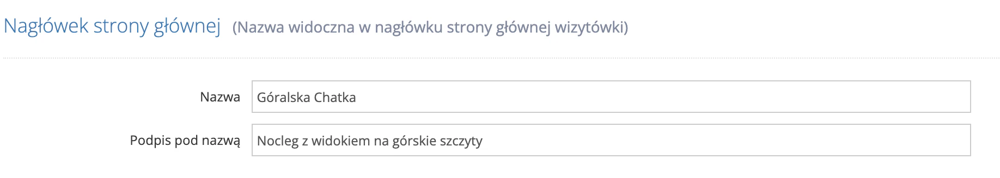
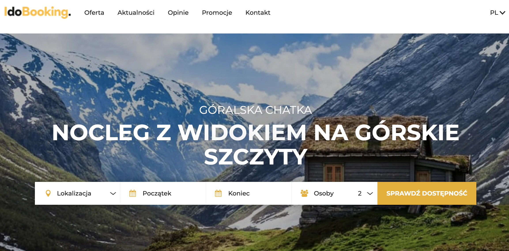
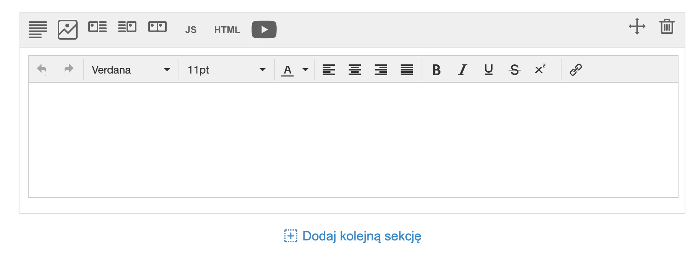

# Konfiguracja strony głównej

Źródło: [iDoBooking](https://pomoc.idobooking.com/strona-www/szablon-strony-www/strona-glowna)

Kopia: 24.10.2026. [Pełny zrzut](poradnik-edycji-wizytowki.jpg).

[Strona WWW](https://pomoc.idobooking.com/strona-www)/

Szablon strony WWW

# Konfiguracja strony głównej

#### **W tym artykule dowiesz się jak:**

- Samodzielnie skonfigurować główną stronę wizytówki

Aby rozpocząć konfigurację, przejdź do zakładki **Wizytówka > Ustawienia wizytówki > w górnej części menu "Strona główna".**

## **Nagłówek strony głównej**

 

Rozpocznij od uzupełnienia **Nagłówka strony głównej**. Jest to tytuł, który będzie wyświetlał się w widocznym miejscu na stronie startowej Twojej Wizytówki. Może być to na przykład **nazwa Twojego obiektu noclegowego**. Jeżeli znajduje się on w jakiejś małej miejscowości warto dopisać w tytule rejon lub okoliczne miasto. Dzięki temu goście szukający noclegu poprzez wyszukiwarkę łatwiej trafią na Twoją stronę.

Dla przykładu: nazwa i podpis wprowadzony widoczny na zdjęciu poniżej

Będzie widoczny na głównej stronie wizytówki w taki sposób:

## Strona "O nas"

 

W tej części możesz rozpocząć budowanie swojej strony. Możesz napisać tam wszystko co uznasz za ważne i ciekawe z punktu widzenia gości np. położenie, ciekawą historię obiektu lub wyjątkowe walory tego miejsca. Po kliknięciu w przycisk "Dodaj kolejną sekcję" pojawi się pole z prostym edytorem umożliwiającym dodanie dowolnych treści i zdjęć. Jest również możliwość zamieszczenia filmu z Youtube.

Niezwykle ważne jest ustawienie **znaczników META**. Mają one wpływ na pozycjonowanie Twojej strony. W kilku słowach opisz czego dotyczy strona i jakie informacje odwiedzający mogą na niej znaleźć.

## Własny kod HTML/JavaScript

 

Poniżej znajdziesz miejsce na dodanie własnego kodu HTML/JavaScript, do odpowiednich sekcji na stronie. Jeżeli znasz się na kodowaniu i chcesz wzbogacić swoją stronę o nowe elementy, możesz to zrobić w tym miejscu. Opcja przeznaczona jest dla bardziej zaawansowanych użytkowników i uzupełnianie jej nie jest konieczne do uruchomienia strony wizytówki. 

## Zdjęcia

 

Następnie dodaj **zdjęcia na stronę główną**. Wybierz najlepsze fotografie prezentujące Twój obiekt, okolicę, pokoje lub na przykład salę konferencyjną czy siłownię. Wybór ten jest niezwykle istotny ponieważ będą one **pierwszą rzeczą jaką zobaczą** odwiedzający Twoją witrynę. Galerię możesz również wzbogacić dodając film.
Uwaga: zdjęcia dodane w tym miejscu możesz użyć również do poszczególnych sekcji na stronie wizytówce, jeżeli zdjęcie zostanie użyte w dowolnym elemencie, nie będzie wyświetlało się jako główne na stronie. 

Uwaga

Dodane **zdjęcie/wideo** nie może mieć więcej niż 10MB
