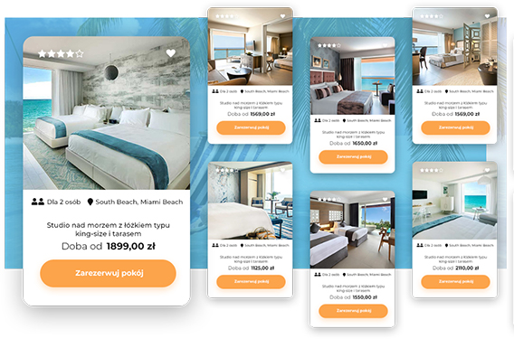

# Dostęp do demo

Źródło: [iDoBooking](https://api.idobooking.com/pl/demo/przetestuj-system-w-wersji-demo/)

Kopia: 24.10.2026. [Pełny zrzut](przetestuj-system-w-wersji-demo.jpg).

NAJLEPSZE ROZWIĄZANIA DO ZARZĄDZANIA REZERWACJAMI
 
 

# Jak zacząć? Przetestuj nas w akcji!

 
 
 
Możesz skorzystać z darmowego DEMO lub zamówić od razu system na własny użytek z okresem próbnym:

 

 
 

### **DEMO**

 
 
 
**Darmowy dostęp bez zobowiązań**
 **7 dni testów**(z opcją przedłużenia dostępu)
 **bez pełnego dostępu do Channel Managera**
 sprawdź, jak wygląda system IdoBooking uzupełniony o przykładowe treści

 

 

 
 

### **Wersja pełna**

 
 
 
**[Już od 99 zł za rok](https://www.idobooking.com/pl/cennik-idobooking/)**
 **30-dniowy okres próbny** (z możliwością zwrotu kosztów)
 **pełen dostęp do [Channel Managera](https://www.idobooking.com/pl/mozliwosci-systemu-rezerwacji-idobooking/channel-manager-prezentacja-oferty-w-roznych-systemach-rezerwacji/)**
 zachowaj konfigurację Twojego obiektu i przetestuj Channel Manager

 

 
 

 
 
 
 
 
 
 
 
 
 
 
 

 

 

 

 
 

# Kiedy wybrać wersję DEMO?

 
 
 
**Wybierz tę opcję, jeżeli** chcesz zobaczyć, jak wygląda system IdoBooking uzupełniony o przykładowe treści. Nie musisz tracić czasu na wprowadzenie własnej konfiguracji, a my automatycznie po zakończeniu Twoich testów bezpiecznie wykasujemy wszystkie dane. Demo jest dostępne bezpłatnie na 7 dni. Istnieje możliwość samodzielnego przedłużenia tego okresu. 

 **Korzystanie z DEMO nie pociąga za sobą żadnych kosztów i obowiązków zamówienia systemu rezerwacji.**

 

 
 

# Kiedy zamówić od razu pełną wersję systemu?

 
 
 
**Wybierz tę opcję, jeżeli** chcesz od razu zachować konfigurację Twojego obiektu i przetestować połączenie z Channel Managerem. Na start oferujemy 30-dniowy okres próbny. W tym czasie nie ponosisz kosztów obsługi rezerwacji i możesz przetestować dowolną liczbę integracji z Channel Managerem. W przypadku rezygnacji w okresie testowym gwarantujemy zwrot kosztu opłaty abonamentowej pobranej przy aktywacji. Jeżeli zostaniesz z nami, wszystkie Twoje ustawienia z okresu próbnego zostaną zachowane.

 

 

