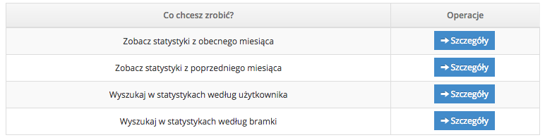
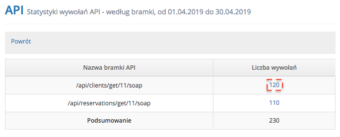
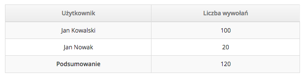
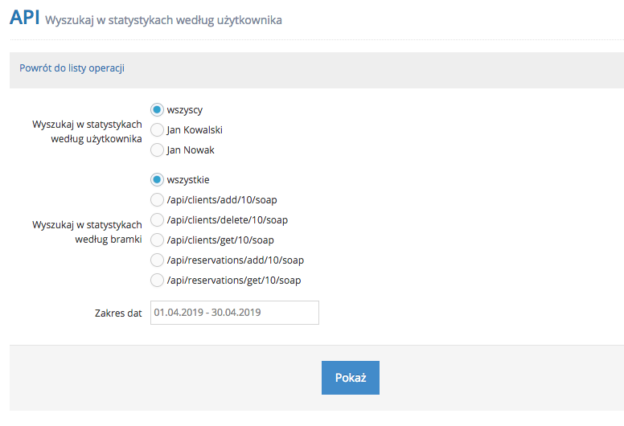
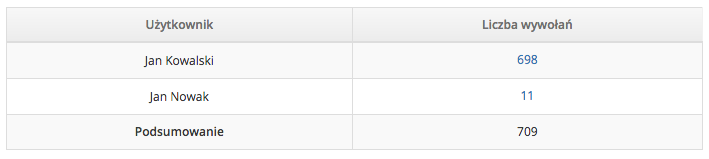

# Statystyki API

Źródło: [iDoBooking](https://api.idobooking.com/pl/developers/statystyki-api/)

Kopia: 24.10.2026. [Pełny zrzut](statystyki-api.jpg).

Dostępne w panelu IdoBooking **Statystyki API** to bardzo przydatny zestaw informacji, dzięki którym możesz dowiedzieć się ze szczegółowych raportów, jak często i które wywoływane są bramki w API.
 
Do wykorzystania masz raporty:
 
 
- z obecnego miesiąca 
- z poprzedniego miesiąca 
- z możliwością wyszukiwania zapytań i odpowiedzi według użytkownika 
- z możliwością wyszukiwania zapytań i odpowiedzi według bramki 
 

 
W przypadku analizy statystyk API z obecnego miesiąca i poprzedniego miesiąca dostaniesz raport z wywoływanymi bramkami i ich ilością wywołań:
 

 
Jeśli natomiast chciałbyś zobaczyć którzy użytkownicy wykonywali zapytania, to wystarczy że klikniesz w link z ilością wywołań:
 

 
W przypadku statystyk API wyszukiwanych według użytkownika i bramki, wybierz którego użytkownika i bramkę chcesz analizować a także wybierz zakres dat, które Cię interesują:
 

 
Następnie w przypadku wyszukiwania według użytkownika, zobaczysz którzy użytkownicy ile razy wywoływali bramki:
 

 
a w przypadku wyszukiwania według bramki, zobaczysz ilość wywołań konkretnej bramki:
 

