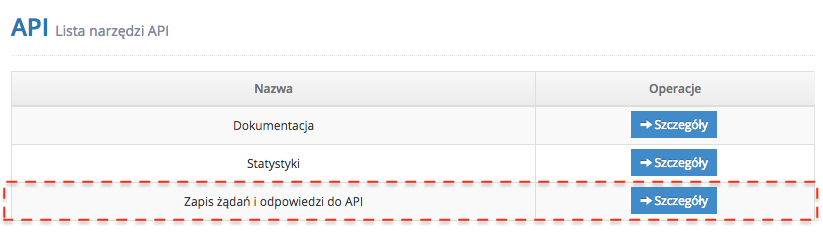
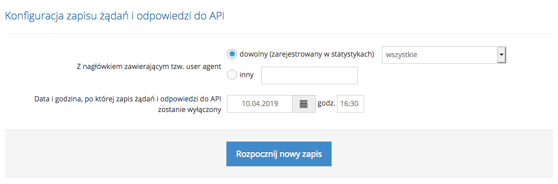

# Zapis żądań i odpowiedzi do API

Źródło: [iDoBooking](https://api.idobooking.com/pl/developers/zapis-zadan-i-odpowiedzi-do-api/)

Kopia: 24.10.2026. [Pełny zrzut](zapis-zadan-i-odpowiedzi-do-api.jpg).

Dostępny w panelu IdoBooking **zapis żądań i odpowiedzi do API** to mechanizm dzięki któremu jako Developer masz możliwość zbierania w czasie rzeczywistym informacji dotyczących:
 
 
- daty i godziny rozpoczęcia wykonywania poszczególnych zapytań i ich odpowiedzi, 
- data i godziny zakończenia wykonywania poszczególnych zapytań i ich odpowiedzi, 
- czasu wykonywania poszczególnych zapytań i ich odpowiedzi, 
- identyfikatorów UAString (user-agent) zawartych w metadanych nagłówków HTTP poszczególnych zapytań i ich odpowiedzi 
 
Jest to także narzędzie, które pomoże Ci sprawdzić czy wykonywane przez Twoje programy lub skrypty, zapytania API posiadają właściwą i wymaganą przez daną bramkę strukturę i czy są przez nią poprawnie przetwarzane oraz już na wczesnym etapie zidentyfikować i wyeliminować występujące w nich problemy zapewniając im bardziej optymalne działanie. Jest to więc świetne narzędzie dla Developera, który tworzy własne programy czy indywidualne integracje.
 

## Konfiguracja zapisu żądania i odpowiedzi wybranego interfejsu API

 
Chcąc włączyć rejestrację żądań i odpowiedzi do API, przejdź w panelu IdoBooking do strony **ADMINISTRACJA / API**, a następnie wybierz Zapis żądań i odpowiedzi do API.
 

 
Następnie wybierz user agent'a:
 
 
- dowolnego (zarejestrowanego w statystykach) 
- innego - user agent własnej dowolnej aplikacji 
 
Wybranie konkretnego user agenta pozwoli Ci odfiltrować z logów niepotrzebne żądania i zapisać w nich tylko te, które będą wykonywane przez interesującą Cię aplikację czy inny wykonywany skrypt.
 
Ostatnim krokiem w konfiguracji jest wybór ram czasowych w jakich zapis żądań i odpowiedzi API ma być nasłuchiwany. W tym miejscu wskaż datę oraz konkretną godzinę do kiedy narzędzie ma nasłuchiwać zapis.
 

 
Po skonfigurowaniu powyższych opcji Rozpocznij nowy zapis.
 

## Pobieranie logów żądań i odpowiedzi do API

 
Każdy rejestrowany typ żądania i odpowiedzi jest umieszczany w postaci osobno zapisywanych plików XML, gotowych do analizy. Aby pobrać cały zapis wystarczy kliknąć w przycisk Pobierz logi żądań i odpowiedzi API i będzie dostępny w postaci pliku zip.
 
Należy pamiętać, że **logi żądań i odpowiedzi do API są automatycznie kasowane po upływie 1 miesiąca od daty zapisu**.
